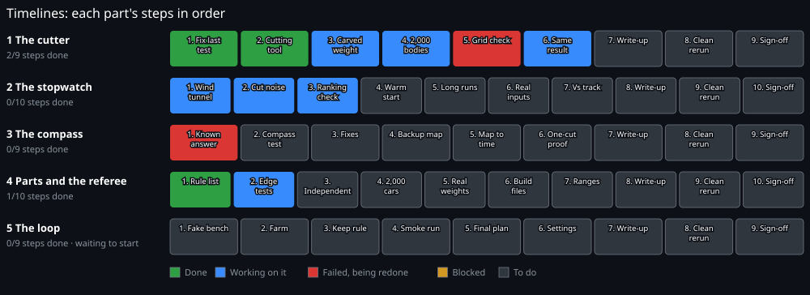
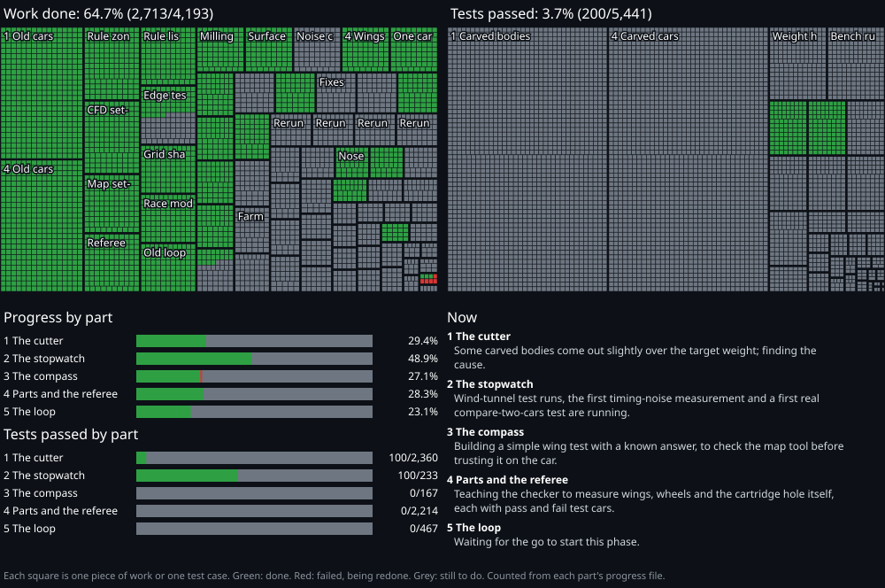

# STEM Racing car: progress

Our team is building, part by part, a computer system that designs the fastest legal car for the STEM Racing 20 m race. This page shows how far each part has come. It holds **no code and no design data**, only progress.

## Status

   

**[Live panel: what each part is doing and what is running now](https://shawshanker18.github.io/stem-racing-progress/live.html)** · [Full progress, part by part](https://shawshanker18.github.io/stem-racing-progress/progress.html) · [Progress history](https://shawshanker18.github.io/stem-racing-progress/history.html)

Each square is one piece of work or one test case, counted from each part's progress file. "Groundwork" is work finished before this phase. Each part's builder updates its own file after every step.

## Ready to start?

- **Part 3 (The compass):** ✅ **Ready to start.**
- **Part 5 (The loop):** ⏳ Not yet. Waiting for D (Full-car building finished and tested, Part 4).

| Milestone | From | Done |
|---|---|---|
| A: Cutting tool finished and tested | Part 1 | ✅ 2026-11-09 |
| B: Timing noise measured (helps Part 3, not required) | Part 2 | ✅ 2026-11-09 |
| C: Compare-two-cars finished and tested | Part 2 | ✅ 2026-11-09 |
| D: Full-car building finished and tested | Part 4 | ⬜ not yet |

## The five parts

### 1. The cutter

*Carves the car body out of the legal block, one safe cut at a time.* 35.1% · being built

- Starts from the full block of material the rules allow, with every rule zone already marked.
- Moves the surface in or out wherever it is told, in small steps, and checks every rule after each step: required solid areas, required open areas, left-right symmetry, one single piece, and a shape a real milling machine can cut.
- Re-sizes the whole body after each cut so the car always weighs the target.
- Hands over a clean, closed 3D shape. It never decides what is faster; it only cuts safely.

**Now:** No tag yet. Part 1 has its own chat again (11 Nov). Grid check of 20 bodies on the newest cutter (fedc582): 19 read, all 0.10 to 0.48 % against the 0.5 % mark; body 2 still running. Unit tests: 3 of 4 groups green, 1 running. Reviewed the two cutter changes (corner relief for every body; big loose pieces joined, not dropped): no fault found. Next: 200-body weight sizing, 200-body random carving, then the tag.

**Timeline:** 3 of 9 steps done

| # | Step | Status | Started | Finished | Note |
|---|---|---|---|---|---|
| 1 | Fix the last failing test | ✅ Done | 2026-11-09 | 2026-11-09 | Both failing tests fixed; every check passes. |
| 2 | Build the cutting tool | ✅ Done | 2026-11-09 | 2026-11-09 | Built and all its checks pass; other parts can now use it. |
| 3 | Weight sizing for carved shapes | 🔄 Working on it | 2026-11-09 |  | Rerun needed on the fixed cutter; the Part 1 chat starts it. |
| 4 | Big random carving test (2,000 bodies) | ⏸️ Blocked | 2026-11-09 |  | Waits for the frozen tag: Part 4's cars pass on fef4130; own checks still running. |
| 5 | Grid-size check | 🔄 Working on it | 2026-11-09 |  | 19 of 20 bodies between 0.10 and 0.48 % after the two fixes; last body still running. |
| 6 | Same result on every machine | ✅ Done | 2026-11-09 | 2026-11-10 | Same-result test green on the current cutter. |
| 7 | Write-up | ⬜ To do |  |  |  |
| 8 | Full clean rerun of every test | ⬜ To do |  |  |  |
| 9 | Team sign-off | ⬜ To do |  |  |  |

### 2. The stopwatch

*Times a finished car over the 20 m race.* 61.8% · being built

- An airflow simulation measures how hard the air pushes back on the car and its wheels.
- A race model turns that push, the weight and the launch into a race time, and says which inputs matter most.
- It must be right (checked against published wind-tunnel results), quiet (a tiny change gives a tiny time change) and give the same answer on every machine.
- Every other part trusts it to say which car is faster.

**Now:** Ranking check passed on 20 cars. Timing noise with the reshaped mesh and a warm start: 0.32 to 0.36 ms on 16 cars (95 % range 0.23 to 0.57) against the 0.3 ms mark, so not passed yet. A longer averaging window does not help: each car's own averaging error is already small (0.06 ms); what is left is car-to-car. Two other runs from a different reference car jumped between drag levels again (about 5 ms). A run on the current code with that same reference car is going now to find out whether the jump comes from the reference car or from the older code.

**Timeline:** 1 of 10 steps done

| # | Step | Status | Started | Finished | Note |
|---|---|---|---|---|---|
| 1 | Check against published wind-tunnel results | 🔄 Working on it | 2026-11-09 |  | Drag reads too high so far; testing settings to find out why. |
| 2 | Cut the timing noise | 🔄 Working on it | 2026-11-09 |  | Re-measured without the early stop: far above target. Cars jump between three drag levels; testing whether the mesh or the airflow causes it. |
| 3 | Quick vs detailed ranking check | ✅ Done | 2026-11-09 | 2026-11-10 | Passed: the quick mesh orders twenty cars the same way as the detailed mesh, well above the pass marks. |
| 4 | Warm start | ⬜ To do |  |  |  |
| 5 | Runs longer than one machine slot | ⬜ To do |  |  |  |
| 6 | Real race inputs from the team | 🔄 Working on it | 2026-11-09 |  | Partly done: the team's measured thrust is in. Rolling friction, wheel weights and tether drag are still to come. |
| 7 | Model vs real track times | ⬜ To do |  |  |  |
| 8 | Write-up | ⬜ To do |  |  |  |
| 9 | Full clean rerun of every test | ⬜ To do |  |  |  |
| 10 | Team sign-off | ⬜ To do |  |  |  |

### 3. The compass

*Draws a map over the car showing where a cut would make it faster.* 44.4% · being built

- Looks at one car and draws a map over its whole surface: where pushing the surface in or out would make the race time faster or slower.
- One special simulation gives the whole map for about the cost of one normal run.
- The cutter carves along this map, so the map must be proven against real measurements before anyone trusts it.
- If the fast map cannot be made right, a slower map built from direct measurements is the backup.

**Now:** Car pilot is ready and its trial run worked end to end. It waits for Part 1 to freeze its cutter and Part 2 to finish its noise work.

**Timeline:** 0 of 9 steps done

| # | Step | Status | Started | Finished | Note |
|---|---|---|---|---|---|
| 1 | Known-answer test | ❌ Failed, being redone | 2026-11-09 |  | Fast map fails on every setting tried, including the maker's own full setup; the backup measured map passes. |
| 2 | Compass test on the car | ⏸️ Blocked |  |  | Blocked: waiting on Part 2 to find why near-identical cars settle on different drag levels; measured car slopes cannot be trusted until then. |
| 3 | Fixes, tried in order | ⬜ To do |  |  |  |
| 4 | Backup measured map (only if needed) | 🔄 Working on it | 2026-11-09 |  | Passed on the simple wing: matched every test shape it had not seen. Waiting for quieter car runs before trying it on cars. |
| 5 | Map to race time | 🔄 Working on it | 2026-11-09 |  | Built and its check against the race model passes, including where the weight sits; waiting for Part 1 to confirm how it re-sizes the skin. |
| 6 | One-cut proof | ⬜ To do |  |  |  |
| 7 | Write-up | ⬜ To do |  |  |  |
| 8 | Full clean rerun of every test | ⬜ To do |  |  |  |
| 9 | Team sign-off | ⬜ To do |  |  |  |

### 4. Parts and the referee

*Turns a carved body into a whole car, makes the build files, and judges it.* 33.1% · being built

- Adds everything except the body: nose, front and rear wings, wheel supports, wheels, tether guides and the cartridge, and cuts the joints into the body.
- Makes the files the team needs to print the parts and mill the body.
- Holds the referee: an independent check of the finished car against every rule, measured from the outside like a scrutineer, showing how much room is left on each rule.
- The referee shares nothing with the cutter, so one cannot hide the other's mistakes.

**Now:** Reference cars: 3 cars, 162 checks each, none failed. Canary of 200 randomly carved cars: 150 legal, 50 not, no crashes. Most of the 50 are carves that left no room for the team number or the logo, or are too thin, which the referee is right to reject. To fix: 10 cars miss 3 to 7 cubic mm of cargo on carved side walls, 2 have 6 to 7 cubic mm of halo in the foam, 1 is 0.08 mm over the rear overhang, and 12 have sliver triangles in the mesh. These wait for the body builder's grid fix, then get rechecked.

**Timeline:** 3 of 10 steps done

| # | Step | Status | Started | Finished | Note |
|---|---|---|---|---|---|
| 1 | List every rule and its check | ✅ Done | 2026-11-09 | 2026-11-09 | Every rule matched to a check or a reason, none left open. |
| 2 | Just-inside and just-outside tests | ✅ Done | 2026-11-09 | 2026-11-09 | Every size rule has a pass car and a fail car; all tests pass on GitHub. |
| 3 | Make the referee independent | ✅ Done | 2026-11-09 | 2026-11-09 | The checker uses only its own rule numbers; tests pass. |
| 4 | Parts on carved bodies (2,000 cars) | 🔄 Working on it | 2026-11-09 |  | Trial runs on the body builder's changing code, to find crashes and new kinds of rejects; the counted run waits for its frozen version. |
| 5 | Real part weights | ⬜ To do |  |  |  |
| 6 | Build files | 🔄 Working on it | 2026-11-09 |  | Parts list done; thinnest walls measured; waiting for the team's printer limits and a makeable check. |
| 7 | Part setting ranges | ⬜ To do |  |  |  |
| 8 | Write-up | ⬜ To do |  |  |  |
| 9 | Full clean rerun of every test | ⬜ To do |  |  |  |
| 10 | Team sign-off | ⬜ To do |  |  |  |

### 5. The loop

*Runs the whole search and proves every step it keeps.* 23.1% · waiting to start

- Times the car, reads the map, tries a few cuts of different sizes, builds and judges each one, times them all, and keeps a cut only if the car is clearly faster.
- Runs many cars at once across many cloud machines, and picks up where it left off if a machine stops.
- Writes a certificate for the final car: every kept step and the proof it helped.
- In this phase it is only built and tested. The real search for the best car comes later.

**Now:** Waiting for the go to start this phase.

**Timeline:** 0 of 9 steps done

| # | Step | Status | Started | Finished | Note |
|---|---|---|---|---|---|
| 1 | Test bench with fake timings | ⬜ To do |  |  |  |
| 2 | Machine farm | ⬜ To do |  |  |  |
| 3 | Keep-rule check on real runs | ⬜ To do |  |  |  |
| 4 | Small smoke run | ⬜ To do |  |  |  |
| 5 | Final-run plan (ready, not started) | ⬜ To do |  |  |  |
| 6 | Settings searched together | ⬜ To do |  |  |  |
| 7 | Write-up | ⬜ To do |  |  |  |
| 8 | Full clean rerun of every test | ⬜ To do |  |  |  |
| 9 | Team sign-off | ⬜ To do |  |  |  |

---

*Drawn automatically from the progress files. Nothing here can be used to rebuild the work.*
