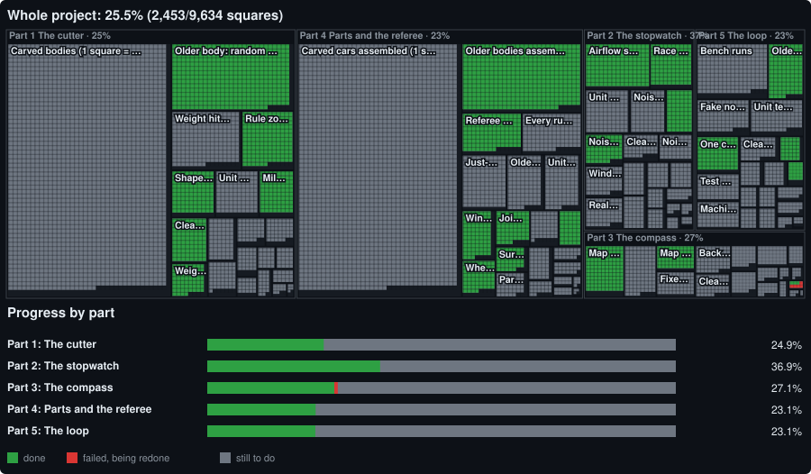
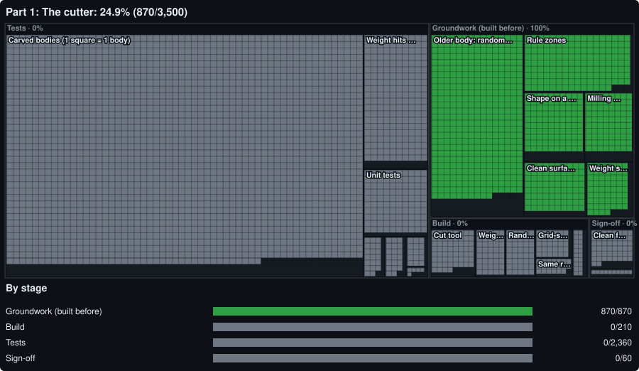
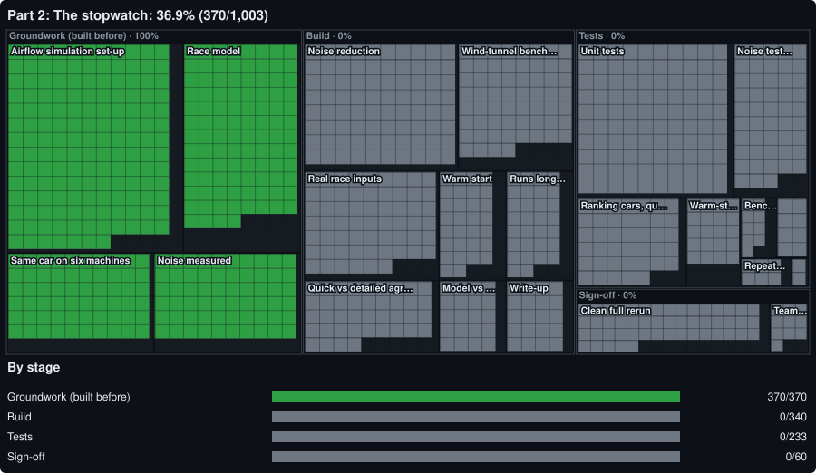
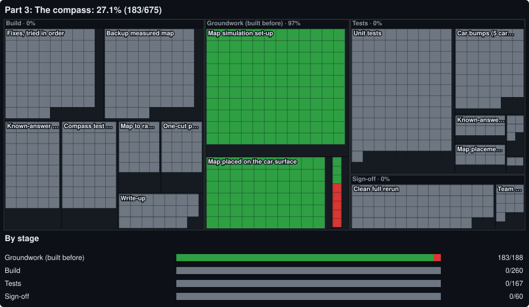
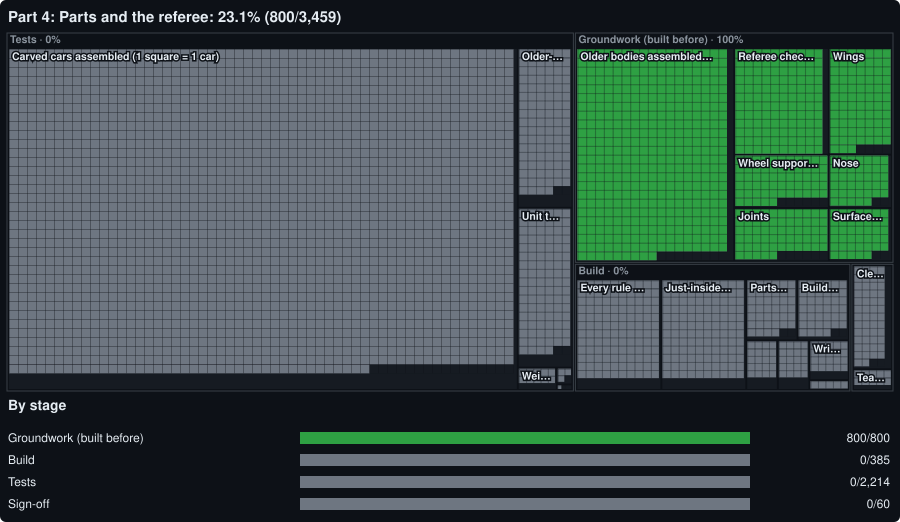
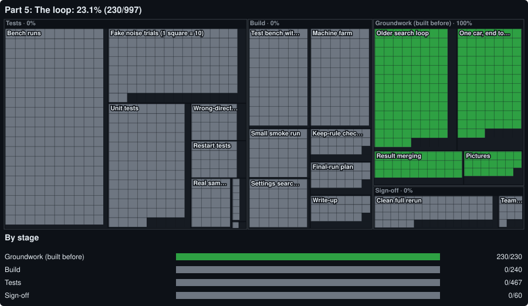

# STEM Racing car: progress board

Our team is building, part by part, a computer system that designs the fastest legal car for the STEM Racing 20 m race. This board shows how far each part has come. It holds **no code and no design data**, only progress.

Each small square is one piece of work or one test case. **Green** = done, **red** = failed and being redone, **grey** = still to do. Each part's own builder updates its file after every step, and the pictures redraw themselves.

## Part 1: The cutter

*Carves the car body out of the legal block, one safe cut at a time.*

**Status:** Waiting to start · **24.9%** · updated 2026-11-09

**What it does**

- Starts from the full block of material the rules allow, with every rule zone already marked.
- Moves the surface in or out wherever it is told, in small steps, and checks every rule after each step: required solid areas, required open areas, left-right symmetry, one single piece, and a shape a real milling machine can cut.
- Re-sizes the whole body after each cut so the car always weighs the target.
- Hands over a clean, closed 3D shape. It never decides what is faster; it only cuts safely.

**Now:** Waiting for the go to start this phase.

**Recent steps**

- 2026-11-09: Board created. Waiting for the go to start this phase.

## Part 2: The stopwatch

*Times a finished car over the 20 m race.*

**Status:** Waiting to start · **36.9%** · updated 2026-11-09

**What it does**

- An airflow simulation measures how hard the air pushes back on the car and its wheels.
- A race model turns that push, the weight and the launch into a race time, and says which inputs matter most.
- It must be right (checked against published wind-tunnel results), quiet (a tiny change gives a tiny time change) and give the same answer on every machine.
- Every other part trusts it to say which car is faster.

**Now:** Waiting for the go to start this phase.

**Recent steps**

- 2026-11-09: Board created. Waiting for the go to start this phase.

## Part 3: The compass

*Draws a map over the car showing where a cut would make it faster.*

**Status:** Waiting to start · **27.1%** · updated 2026-11-09

**What it does**

- Looks at one car and draws a map over its whole surface: where pushing the surface in or out would make the race time faster or slower.
- One special simulation gives the whole map for about the cost of one normal run.
- The cutter carves along this map, so the map must be proven against real measurements before anyone trusts it.
- If the fast map cannot be made right, a slower map built from direct measurements is the backup.

**Now:** Waiting for the go to start this phase.

**Recent steps**

- 2026-11-09: Board created. Waiting for the go to start this phase.

## Part 4: Parts and the referee

*Turns a carved body into a whole car, makes the build files, and judges it.*

**Status:** Waiting to start · **23.1%** · updated 2026-11-09

**What it does**

- Adds everything except the body: nose, front and rear wings, wheel supports, wheels, tether guides and the cartridge, and cuts the joints into the body.
- Makes the files the team needs to print the parts and mill the body.
- Holds the referee: an independent check of the finished car against every rule, measured from the outside like a scrutineer, showing how much room is left on each rule.
- The referee shares nothing with the cutter, so one cannot hide the other's mistakes.

**Now:** Waiting for the go to start this phase.

**Recent steps**

- 2026-11-09: Board created. Waiting for the go to start this phase.

## Part 5: The loop

*Runs the whole search and proves every step it keeps.*

**Status:** Waiting to start · **23.1%** · updated 2026-11-09

**What it does**

- Times the car, reads the map, tries a few cuts of different sizes, builds and judges each one, times them all, and keeps a cut only if the car is clearly faster.
- Runs many cars at once across many cloud machines, and picks up where it left off if a machine stops.
- Writes a certificate for the final car: every kept step and the proof it helped.
- In this phase it is only built and tested. The real search for the best car comes later.

**Now:** Waiting for the go to start this phase.

**Recent steps**

- 2026-11-09: Board created. Waiting for the go to start this phase.

---

*This board is drawn automatically from each part's progress file.*
